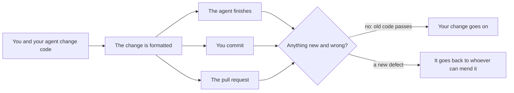
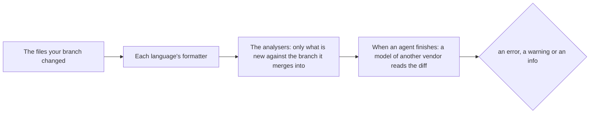

# rudnik-review

One formatter and one review for every language you write, inside the agent you already use. For the same with pictures, open
[guide.html](guide.html) from your clone in a browser.

Agents write code fast, and fast code leaves small defects behind: an `eval` on user input, a secret in a test, an import nobody
uses. rudnik-review formats what you change and stops a change that adds a new defect: when the agent finishes, when you commit,
and on the pull request. Code that was there before never blocks you, so it does not nag about the past.

The same check stands at three doors, and only something new you brought is ever sent back.

## Install, once a machine
You need git and uv (https://docs.astral.sh/uv). macOS, Linux and Windows, less the analysers its Needs exclude.

    uv tool install git+https://github.com/ivansttt/rudnik-review

With ssh keys: `git+ssh://git@github.com/ivansttt/rudnik-review`.

## Set up a repository, once a clone

    rudnik-review init           # wires what it finds here: Cursor, Claude Code, Codex, JetBrains, and git's commit
    rudnik-review init github    # the pull request's check, once a repository
    rudnik-review                # sets up the tools this repository's languages need, then checks

Commit the files `init` wrote. The first of you also runs `rudnik-review fmt --all` and commits that alone, so a formatter rewrites
whole files once and not inside your changes. Claude Code: accept the rudnik-review plugin it offers (`init claude` where `init`
saw none). Codex: open `/hooks` once and trust the hook `init` installed, and again after it changes.

Ten minutes, once, with each language's Needs below in place: after that you work as you always did.

## What happens then
- Cursor, Claude Code, Codex: the agent's change is formatted when it finishes, and it cannot finish while the change holds a
  new error. It gets the finding back and mends it.
- JetBrains: files are formatted when you save. Junie has `check` and `explain` as tools and is told to run them. For AI
  Assistant, paste the one line `init` printed into its MCP settings.
- `git commit` is refused while what you staged holds a new error.
- The pull request's `rudnik-review` check fails on one, and shows each finding on its line.

Say you ask the agent for a calculator endpoint and it writes `return eval(expression)`. When it tries to finish, it gets back:

    error api/calc.py:12 ruff S307: Use of possibly insecure function; consider using `ast.literal_eval` 7c2e…

and it does not stop there: it parses the expression instead, the check runs again and is quiet, and the agent finishes. The
unused import two lines up is reported as a warning, which you may mend or leave. The code at the end of the line is the finding's
fingerprint (shortened here).

## By hand

    rudnik-review                        # what this branch adds, the tools it needs set up first: an error stops you
    rudnik-review fmt                    # format the files you changed
    rudnik-review check --format sarif   # .rudnik/review.sarif, which a JetBrains IDE opens
    rudnik-review update                 # the next release and its tools

A finding you are sure is wrong: do not work around it. Answer `NOTE-WRONG: <fingerprint>: <why>` in the agent's reply.

## What one check does

Your changed files, formatted, then read by the analysers and, when an agent finishes or on `check --llm`, by a model of another
vendor than the change's; never on a commit, the pull request or a bare `rudnik-review`. It uses the CLI you are signed in to
(Codex or Claude Code), never a key from us: with none, it is skipped and says so once.

Your own model, any server speaking OpenAI's chat API (omlx, llama.cpp's, LM Studio, ollama), can ask each learnt rule of the hunks it applies to, at no cost a call; its yes never blocks:

    rudnik-review check --local http://localhost:8080/v1#qwen3-coder   # or RUDNIK_REVIEW_LOCAL; no #model: the server's first

It also reviews each changed file freely, and a thinking model traces each claim; one it finds real is a note that never blocks:

    rudnik-review check --local http://localhost:11434/v1#qwen2.5-coder:14b --local-verifier http://localhost:11434/v1#qwen3.5:9b   # or RUDNIK_REVIEW_LOCAL_VERIFIER; none: --local's

## Languages
| Language               | Formatter          | Analysers                                                                       | Needs                                                                                      |
|------------------------|--------------------|---------------------------------------------------------------------------------|--------------------------------------------------------------------------------------------|
| Python                 | ruff format        | **ruff**, **basedpyright**, pylint, vulture                                     |                                                                                            |
| JavaScript, TypeScript | biome format       | **biome**                                                                       |                                                                                            |
| Go                     | gofmt              | **golangci-lint**                                                               | Go's toolchain                                                                             |
| Rust                   | cargo fmt          | none                                                                            | cargo                                                                                      |
| Java                   | google-java-format | pmd, cpd, **error-prone**, spotbugs, infer                                      | a JDK, mvn or gradle; not Windows: error-prone, spotbugs; infer: Linux x86_64, macOS arm64 |
| Kotlin                 | ktlint             | ktlint                                                                          | Java; not Windows                                                                          |
| C#                     | dotnet format      | **roslyn**                                                                      | a dotnet SDK, jq, python3; not Windows                                                     |
| C, C++                 | clang-format       | none                                                                            |                                                                                            |
| Swift                  | swift format       | none                                                                            | Swift's toolchain                                                                          |
| Shell                  | shfmt              | **shellcheck**                                                                  |                                                                                            |
| SQL                    | sqlfluff format    | sqlfluff, squawk (PostgreSQL migrations)                                        |                                                                                            |
| YAML                   | yamlfmt            | actionlint (GitHub workflows)                                                   |                                                                                            |
| TOML                   | taplo              | none                                                                            |                                                                                            |
| Terraform              | terraform fmt      | tflint                                                                          | terraform                                                                                  |
| Dockerfile             | none               | hadolint                                                                        |                                                                                            |
| GDScript               | none               | gdlint, godot (Godot's own warnings)                                            | Godot, for its warnings                                                                    |
| every file             |                    | **gitleaks**, **trufflehog** (secrets), osv-scanner, **trivy**, semgrep, lizard | not Windows: trufflehog, trivy                                                             |

An analyser in bold stops a change on the rules no reader disputes (an `eval`, a secret); the rest only warn. Markdown is left as you wrote it.

## When something is off
- `not installed: ...`: run `rudnik-review setup`. One `(no build for ...)` setup cannot install here: the check goes on without it.
- Finished work is refused for code you pushed earlier: the check compares with the default branch, as the pull request does.
  In a clone made without `git clone`: `git remote set-head origin --auto`.
- The pull request cannot find the action: the owner allows it under this repository's Settings, Actions, General, Access. A
  repository of another owner needs a token; ask the owner.
- yamlfmt removed your blank lines: commit a `.yamlfmt` holding `formatter:` and, under it, `retain_line_breaks: true`.
- `update` fails on Windows: run `uv tool upgrade rudnik-review`, then `rudnik-review setup`.
